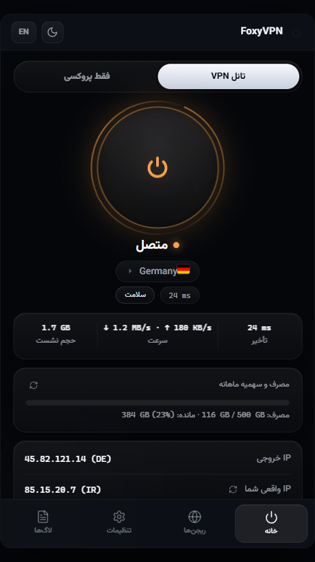
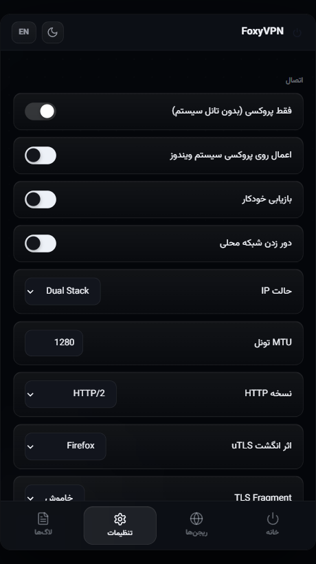
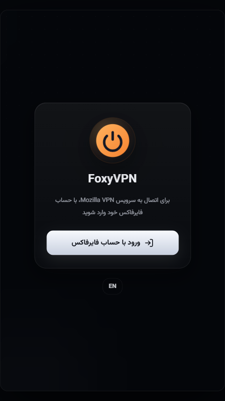

<div align="center">


# FoxyVPN

**Unofficial Mozilla VPN client for Windows & Android**

[](../../releases/latest)
[](../../releases)
[](LICENSE)

[](../../releases/latest)
[](../../releases/latest)

</div>

<div dir="rtl">

## معرفی

FoxyVPN یک کلاینت غیررسمی برای سرویس Mozilla VPN است که برای ویندوز و اندروید نوشته شده. به‌جای استفاده از سرورهای واسط، مستقیماً به شبکه‌ی لبه‌ی Fastly موزیلا وصل می‌شود و هسته‌ی آن یک نسخه‌ی شخصی‌سازی‌شده از sing-box با پروتکل MASQUE است. ورود با همان حساب فایرفاکسی انجام می‌شود که اشتراک Mozilla VPN روی آن فعال است و برنامه فقط با اندپوینت‌های رسمی موزیلا صحبت می‌کند.

در ویندوز کل سیستم از تونل رد می‌شود، روی اندروید از VpnService استفاده شده، و DNS هم طوری بسته شده که هیچ درخواستی بیرون از تونل نفرستد. علاوه بر تانل کامل، یک حالت «فقط پروکسی» هم دارد که به‌جای تونل، یک پروکسی محلی بالا می‌آورد.

## تصاویر

| | |
|---|---|
|  |  |
|  |  |

## امکانات

- تانل VPN سیستمی با wintun روی ویندوز و VpnService روی اندروید؛ DNS طوری بسته شده که هیچ درخواستی از بیرون تونل نفرستد
- حالت فقط‌پروکسی با شنونده SOCKS5/HTTP روی پورت محلی و امکان اعمال روی پروکسی سیستم ویندوز
- انتخاب ریجن از لیست زنده‌ی سرورهای موزیلا با پرچم SVG واقعی و کش شش ساعته
- جداسازی برنامه‌ها از تونل؛ در ویندوز بر اساس نام پروسه و در اندروید بر اساس پکیج
- تعویض خودکار پاس Guardian پیش از انقضا بدون قطع شدن اتصال، به‌همراه نمایش سهمیه حساب
- عبور از چالش ضدربات Fastly روی کنترل‌پلن، با اثر انگشت uTLS فایرفاکس
- بازیابی خودکار اتصال بعد از تأیید خرابی مسیر، با سوییچ به سرور دیگری در همان کشور
- انتخاب نسخه HTTP، اثر انگشت TLS، تکه‌تکه کردن TLS، پروکسی بالادستی و DoH سفارشی
- رابط دوزبانه فارسی و انگلیسی با تم تیره و روشن، آیکون کنار ساعت و اتصال سریع

## نصب

**ویندوز:** فایل zip را باز کنید و روی FoxyVPN.exe دوبار کلیک کنید. نیازی به نصب ندارد. اولین بار با حساب فایرفاکس وارد می‌شوید.

**اندروید:** فایل universal-release.apk را نصب کنید. اگر گوگل‌پلی هشدار داد، این طبیعی است چون فایل با کلید شخصی امضا شده. بعد از نصب با حساب فایرفاکس وارد شوید.

**انتخاب ریجن:** از تب ریجن‌ها کشور و شهر را انتخاب کنید و دکمه اتصال را بزنید. بقیه تنظیمات روی حالت پیش‌فرض برای بیشتر کاربرها کافی است.

## بیلد از سورس

ویندوز به Go نسخه ۱.۲۵ و Node و WebView2 نیاز دارد. کافی است هسته sing-box فورک‌شده را کنار پروژه بگذارید و build.bat را اجرا کنید:

```bash
git clone --depth 1 --branch foxy-masque https://github.com/Vauth/sing-box.git libs/sing-box
go mod tidy
build.bat
```

اندروید به JDK 17 و Android SDK نیاز دارد و فایل هسته را هم باید جدا دانلود کنید:

```bash
curl -L -o app/libs/libbox.aar https://github.com/Vauth/sing-box/releases/download/v1.0.0-masque/libbox.aar
gradle :app:assembleRelease
```

## تشکر

این پروژه بر پایه کار Vauth/FoxyVPN برای اندروید نوشته شده و هسته تونل آن فورک sing-box است. برای چالش ضدربات و پروتکل، از کار UjuiUjuMandan/firefox-vpn-client الهام گرفتم. پرچم‌ها از lipis/flag-icons و فونت فارسی وزیرمتن است.

## مجوز

کل پروژه با مجوز MIT منتشر شده. فقط یادتان باشد این کلاینت به سرویس‌های موزیلا وصل می‌شود و اگر موزیلا رفتارش را عوض کند ممکن است نیاز به به‌روزرسانی داشته باشد؛ مسئولیت استفاده هم با خود کاربر است.

</div>

### English

FoxyVPN is an unofficial client for Mozilla's Firefox VPN service, written for Windows (Wails + sing-box) and Android. It connects directly to Mozilla's Fastly edge with MASQUE, signs in through Firefox Accounts, and adds censorship-resistance features like TLS fragmentation and a Fastly challenge solver. Everything is MIT-licensed; you need an active Mozilla VPN subscription to actually use it.
