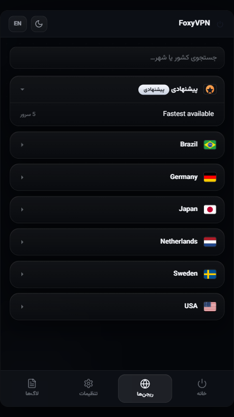

<div align="center">


# FoxyVPN

**Unofficial Mozilla VPN client for Windows & Android**

<div dir="rtl">

کلاینت غیررسمی سرویس **Mozilla Firefox VPN** — تانل MASQUE روی شبکه‌ی لبه‌ی Fastly

</div>

[](../../releases/latest)
[](../../releases)
[](#downloads)
[](LICENSE)

[](../../releases/latest)
[](../../releases/latest)

</div>

---

<div align="center">

## 📸 Screenshots

<table>
  <tr>
    <td align="center"><br><sub><b>Home — connected</b></sub></td>
    <td align="center"><br><sub><b>Regions — real SVG flags</b></sub></td>
  </tr>
  <tr>
    <td align="center"><br><sub><b>Settings — full tunnel control</b></sub></td>
    <td align="center"><br><sub><b>Sign in with Firefox</b></sub></td>
  </tr>
</table>

</div>

## ✨ Features

<div dir="rtl">

• **تانل VPN سیستمی** — wintun روی ویندوز / VpnService روی اندروید، با DNS ضدنشت (DoH زنجیره‌ای و بلاک شدن DoT)
• **حالت فقط‌پروکسی** — شنونده‌ی SOCKS5/HTTP روی `127.0.0.1:1080` + اعمال خودکار روی پروکسی سیستم ویندوز
• **انتخاب ریجن** — لیست زنده از Remote Settings موزیلا (۳۴ کشور) با پرچم‌های SVG واقعی و کش ۶ ساعته
• **Split Tunneling** — بر اساس نام پروسه در ویندوز / بر اساس پکیج در اندروید
• **تعویض خودکار JWT** — پاس‌کوتاه‌عمر Guardian پیش از انقضا تعویض می‌شود (`dynamic_bearer_token`) و نمایش سهمیه
• **حل‌کننده‌ی چالش Fastly** — PoW / PAT / client-metrics + اثر انگشت uTLS فایرفاکس روی کنترل‌پلن
• **بازیابی خودکار محدود** — سوییچ سرور داخل همان کشور بعد از تأیید خرابی مسیر
• **HTTP/1.1 · HTTP/2 · HTTP/3**، uTLS، TLS Fragmentation، Custom Edge، پروکسی بالادستی، DoH بوت‌استرپ
• **رابط دوزبانه** فارسی (RTL) و انگلیسی، تم تیره و روشن، آیکون کنار ساعت / Quick Settings

</div>

## 🚀 Quick Start

<div dir="rtl">

۱ — **ویندوز:** zip را باز کنید → دوبار کلیک روی `FoxyVPN.exe` (بدون نصب) → لاگین با حساب فایرفاکس
۲ — **اندروید:** نصب `app-universal-release.apk` → لاگین با حساب فایرفاکس
۳ — ریجن را انتخاب کنید و دکمه‌ی اتصال را بزنید — همین!

</div>

> [!IMPORTANT]
> Requires an active **Mozilla VPN** subscription. This is an *unofficial* client — access, quota and geo-availability are controlled by Mozilla. Both packages are self-signed; the first-install security warnings are expected.

## 🛠 Building from source

<details>
<summary><b>Windows</b> — Go ≥ 1.25 · Node ≥ 18 · WebView2 Runtime</summary>

```bash
git clone --depth 1 --branch foxy-masque https://github.com/Vauth/sing-box.git libs/sing-box
go mod tidy
build.bat   # -> build/FoxyVPN-Portable.exe (wintun.dll embedded)
```

</details>

<details>
<summary><b>Android</b> — JDK 17 · Android SDK (build-tools 35) · Gradle 8.10.2</summary>

```bash
curl -L -o app/libs/libbox.aar https://github.com/Vauth/sing-box/releases/download/v1.0.0-masque/libbox.aar
# sha256: a6a28c7f3cb53f4251d1578f4772f79831395503fdbf91920c6c1e33cc80281c
gradle :app:assembleRelease
```

</details>

## 🙏 Credits

| Project | Role |
|---|---|
| [Vauth/FoxyVPN](https://github.com/Vauth/FoxyVPN) | The Android app this project is based on (MIT) |
| [SagerNet/sing-box](https://github.com/SagerNet/sing-box) · Vauth's MASQUE fork | Tunnel core |
| [UjuiUjuMandan/firefox-vpn-client](https://github.com/UjuiUjuMandan/firefox-vpn-client) | Go reference client |
| [lipis/flag-icons](https://github.com/lipis/flag-icons) · [Vazirmatn](https://github.com/rastikerdar/vazirmatn) | Flags & font |

## 📄 License

MIT — see [LICENSE](LICENSE).

<div align="center">

<div dir="rtl">

⚠️ تغییر سیاست موزیلا ممکن است نیاز به به‌روزرسانی کلاینت داشته باشد — مسئولیت استفاده با کاربر است.

</div>

</div>
